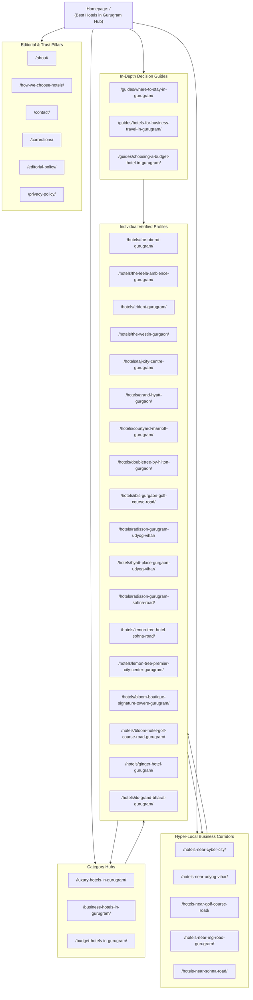

# Gurugram Hotel Directory: Topical Map & Keyword-to-Page Architecture

**Project:** Best Hotels in Gurugram Directory  
**Target Region:** Gurugram (Gurgaon), Haryana, India  
**URL Convention:** Absolute Canonical, trailing slashes consistent (`/`)  
**Status:** Approved Architecture  

---

## 1. Information Architecture Overview

The topical architecture is strictly designed around distinct search intent groups. Each page possesses a unique primary target keyword and non-overlapping content purpose, preventing internal keyword cannibalization while building deep topical authority across Gurugram accommodation topics.

---

## 2. Master Page Inventory & Keyword Strategy Matrix

| Planned URL | Page Type | Primary Target Keyword | Secondary Queries & Concepts | Search Intent | Parent / Breadcrumb | Internal Linking In | Internal Linking Out | Publishing Status |
| :--- | :--- | :--- | :--- | :--- | :--- | :--- | :--- | :--- |
| `/` | Directory Homepage | `best hotels in gurugram` | `top hotels in gurugram`, `hotels in gurugram`, `gurgaon hotel directory`, `where to stay in gurgaon` | Broad evaluation & comparison hub | Root (`Home`) | Header, Footer, Breadcrumbs | All Category Hubs, Location Hubs, Featured Hotels, Core Guides, Methodology | **Active / Published** |
| `/luxury-hotels-in-gurugram/` | Category Hub | `luxury hotels in gurugram` | `5 star hotels in gurugram`, `top 5 star hotels gurgaon`, `best luxury resorts gurugram`, `premium hotels gurgaon` | Premium & executive leisure intent | `/` (`Home > Luxury`) | Homepage, Guides, Luxury Hotel Profiles | The Oberoi, The Leela, Trident, The Westin, Taj City Centre, Grand Hyatt, ITC Grand Bharat, Guides | **Active / Published** |
| `/business-hotels-in-gurugram/` | Category Hub | `business hotels in gurugram` | `hotels in gurugram for business travellers`, `corporate hotels gurgaon`, `meeting venues gurgaon`, `conference hotels gurgaon` | Corporate decision maker, business traveler | `/` (`Home > Business`) | Homepage, Business Guide, Corporate Hotel Profiles | Oberoi, Leela, Westin, Courtyard, Radisson Udyog Vihar, Hyatt Place, Taj City Centre, Business Guide | **Active / Published** |
| `/budget-hotels-in-gurugram/` | Category Hub | `budget hotels in gurugram` | `affordable hotels in gurugram`, `value hotels gurgaon`, `cheap and safe hotels gurugram`, `clean budget stays gurgaon` | Value-conscious traveler, solo traveler | `/` (`Home > Budget`) | Homepage, Budget Guide, Budget Hotel Profiles | ibis Gurgaon, Bloom Boutique Signature Towers, Bloom Golf Course Road, Lemon Tree Sohna Road, Ginger, Budget Guide | **Active / Published** |
| `/hotels-near-cyber-city/` | Location Hub | `hotels near cyber city gurugram` | `hotels near dlf cyber city`, `hotels walking distance cyber hub`, `hotels cyber city rapid metro`, `dlf phase 2 hotels` | Commute-minimizing business traveler | `/` (`Home > Cyber City`) | Homepage, Business Hub, Relevant Profiles, Guides | The Oberoi, The Leela Ambience, Trident, Radisson Udyog Vihar, Cyber City transit guide | **Active / Published** |
| `/hotels-near-udyog-vihar/` | Location Hub | `hotels near udyog vihar` | `hotels in udyog vihar phase 1 2 3 4 5`, `hotels near nh 8 udyog vihar`, `corporate stay udyog vihar gurgaon` | Industrial & corporate business traveler | `/` (`Home > Udyog Vihar`) | Homepage, Location list, Profiles | Trident, The Oberoi, Radisson Gurugram Udyog Vihar, Hyatt Place Udyog Vihar | **Active / Published** |
| `/hotels-near-golf-course-road/` | Location Hub | `hotels near golf course road` | `golf course road hotels gurgaon`, `hotels near one horizon center`, `rapid metro sector 42 53 54 hotels` | High-net-worth business & dining corridor traveler | `/` (`Home > Golf Course Rd`) | Homepage, Location list, Profiles | Grand Hyatt, DoubleTree by Hilton, ibis Gurgaon, Bloom Golf Course Road | **Active / Published** |
| `/hotels-near-mg-road-gurugram/` | Location Hub | `hotels near mg road gurugram` | `mg road gurgaon hotels`, `hotels near sector 29 gurugram`, `hotels near iffco chowk metro`, `mg road mall hotels` | Nightlife, central transit & corporate visitor | `/` (`Home > MG Road`) | Homepage, Location list, Profiles | The Westin Gurgaon, Lemon Tree Premier City Center, Courtyard Marriott, Bloom Signature Towers | **Active / Published** |
| `/hotels-near-sohna-road/` | Location Hub | `hotels near sohna road` | `sohna road hotels gurgaon`, `hotels near subhash chowk badshahpur`, `sector 49 68 hotels gurgaon`, `spr hotels gurgaon` | Tech park & South Gurugram corporate traveler | `/` (`Home > Sohna Road`) | Homepage, Location list, Profiles | Radisson Hotel Sohna Road, Lemon Tree Hotel Sohna Road | **Active / Published** |
| `/hotels/the-oberoi-gurugram/` | Hotel Profile | `the oberoi gurgaon` | `oberoi gurugram address`, `oberoi cyber city business stay`, `the oberoi 5 star gurugram review` | High-intent property researcher | `/hotels/` (`Home > Hotels > The Oberoi`) | Luxury Hub, Cyber City Hub, Udyog Vihar Hub, Business Guide | Official Oberoi website, Cyber City Hub, Luxury Hub, Udyog Vihar Hub | **Active / Published** |
| `/hotels/the-leela-ambience-gurugram/` | Hotel Profile | `the leela ambience gurugram` | `leela ambience gurgaon rooms`, `leela ambience convention hotel`, `leela hotel ambience island nh8` | High-intent property researcher | `/hotels/` (`Home > Hotels > The Leela`) | Luxury Hub, Cyber City Hub, Business Guide | Official Leela site, Cyber City Hub, Luxury Hub | **Active / Published** |
| `/hotels/trident-gurugram/` | Hotel Profile | `trident gurgaon` | `trident udyog vihar gurugram`, `trident resort hotel gurgaon`, `trident oberoi cyber city stay` | High-intent property researcher | `/hotels/` (`Home > Hotels > Trident`) | Luxury Hub, Udyog Vihar Hub, Cyber City Hub | Official Trident site, Udyog Vihar Hub, Luxury Hub | **Active / Published** |
| `/hotels/the-westin-gurgaon/` | Hotel Profile | `the westin gurgaon` | `westin mg road sector 29`, `westin gurgaon business hotel`, `marriott hotels gurugram` | High-intent property researcher | `/hotels/` (`Home > Hotels > The Westin`) | Luxury Hub, Business Hub, MG Road Hub | Official Marriott site, MG Road Hub, Business Hub | **Active / Published** |
| `/hotels/taj-city-centre-gurugram/` | Hotel Profile | `taj city centre gurugram` | `taj sector 44 gurgaon`, `taj hotel near huda city centre`, `5 star hotel sector 44 gurugram` | High-intent property researcher | `/hotels/` (`Home > Hotels > Taj City Centre`) | Luxury Hub, Business Hub, Where to Stay Guide | Official Taj site, Business Hub, Luxury Hub | **Active / Published** |
| `/hotels/grand-hyatt-gurgaon/` | Hotel Profile | `grand hyatt gurgaon` | `grand hyatt sector 58 golf course extension`, `hyatt luxury hotel gurugram` | High-intent property researcher | `/hotels/` (`Home > Hotels > Grand Hyatt`) | Luxury Hub, Golf Course Road Hub | Official Hyatt site, Golf Course Road Hub | **Active / Published** |
| `/hotels/courtyard-marriott-gurugram/` | Hotel Profile | `courtyard by marriott gurugram downtown` | `courtyard marriott sushant lok sector 27`, `marriott downtown gurgaon business hotel` | High-intent property researcher | `/hotels/` (`Home > Hotels > Courtyard`) | Business Hub, MG Road Hub | Official Marriott site, Business Hub | **Active / Published** |
| `/hotels/doubletree-by-hilton-gurgaon/` | Hotel Profile | `doubletree by hilton gurgaon golf course road` | `hilton sector 56 gurgaon`, `doubletree golf course road meeting hotel` | High-intent property researcher | `/hotels/` (`Home > Hotels > DoubleTree`) | Business Hub, Golf Course Road Hub | Official Hilton site, Golf Course Road Hub | **Active / Published** |
| `/hotels/ibis-gurgaon-golf-course-road/` | Hotel Profile | `ibis gurgaon golf course road` | `ibis hotel sector 53 54 rapid metro`, `accor budget hotel gurugram` | High-intent property researcher | `/hotels/` (`Home > Hotels > ibis`) | Budget Hub, Golf Course Road Hub, Budget Guide | Official Accor site, Budget Hub, Golf Course Road Hub | **Active / Published** |
| `/hotels/radisson-gurugram-udyog-vihar/` | Hotel Profile | `radisson gurugram udyog vihar` | `radisson udyog vihar phase 3`, `nh8 business hotel gurugram` | High-intent property researcher | `/hotels/` (`Home > Hotels > Radisson UV`) | Business Hub, Udyog Vihar Hub | Official Radisson site, Udyog Vihar Hub | **Active / Published** |
| `/hotels/hyatt-place-gurgaon-udyog-vihar/` | Hotel Profile | `hyatt place gurgaon udyog vihar` | `hyatt place sector 18 udyog vihar phase 4`, `hyatt corporate stay gurugram` | High-intent property researcher | `/hotels/` (`Home > Hotels > Hyatt Place`) | Business Hub, Udyog Vihar Hub | Official Hyatt site, Udyog Vihar Hub | **Active / Published** |
| `/hotels/radisson-gurugram-sohna-road/` | Hotel Profile | `radisson hotel gurugram sohna road` | `radisson sector 49 sohna road city center`, `business hotel sohna road gurgaon` | High-intent property researcher | `/hotels/` (`Home > Hotels > Radisson Sohna`) | Business Hub, Sohna Road Hub | Official Radisson site, Sohna Road Hub | **Active / Published** |
| `/hotels/lemon-tree-hotel-sohna-road/` | Hotel Profile | `lemon tree hotel sohna road gurugram` | `lemon tree sector 68 gurgaon`, `mid range hotel sohna road` | High-intent property researcher | `/hotels/` (`Home > Hotels > Lemon Tree Sohna`) | Budget Hub, Sohna Road Hub | Official Lemon Tree site, Sohna Road Hub | **Active / Published** |
| `/hotels/lemon-tree-premier-city-center-gurugram/` | Hotel Profile | `lemon tree premier city center gurugram` | `lemon tree sector 29 millennium city centre`, `hotel near sector 29 leisure valley` | High-intent property researcher | `/hotels/` (`Home > Hotels > Lemon Tree Sec 29`) | Business Hub, MG Road Hub, Where to Stay Guide | Official Lemon Tree site, MG Road Hub | **Active / Published** |
| `/hotels/bloom-boutique-signature-towers-gurugram/` | Hotel Profile | `bloom boutique signature towers gurugram` | `bloom hotel sector 29 south city 1`, `affordable boutique hotel gurgaon` | High-intent property researcher | `/hotels/` (`Home > Hotels > Bloom Signature`) | Budget Hub, MG Road Hub, Budget Guide | Official Bloom site, Budget Hub, MG Road Hub | **Active / Published** |
| `/hotels/bloom-hotel-golf-course-road-gurugram/` | Hotel Profile | `bloom hotel golf course road gurugram` | `bloom sector 43 golf course road`, `budget hotel sector 42 43 rapid metro` | High-intent property researcher | `/hotels/` (`Home > Hotels > Bloom Golf Course`) | Budget Hub, Golf Course Road Hub, Budget Guide | Official Bloom site, Golf Course Road Hub | **Active / Published** |
| `/hotels/ginger-hotel-gurugram/` | Hotel Profile | `ginger hotel gurugram` | `ginger sector 1 palam vihar gurgaon`, `ihcl budget hotel gurugram` | High-intent property researcher | `/hotels/` (`Home > Hotels > Ginger`) | Budget Hub, Budget Guide | Official Ginger site, Budget Hub | **Active / Published** |
| `/hotels/itc-grand-bharat-gurugram/` | Hotel Profile | `itc grand bharat gurugram` | `itc grand bharat luxury retreat gurgaon`, `itc golf resort tauru road haryana` | Luxury & wellness destination researcher | `/hotels/` (`Home > Hotels > ITC Grand Bharat`) | Luxury Hub, Where to Stay Guide | Official ITC site, Luxury Hub | **Active / Published** |
| `/guides/where-to-stay-in-gurugram/` | Informational Guide | `where to stay in gurugram` | `best areas to stay in gurgaon`, `gurugram neighborhood guide`, `cyber city vs golf course road vs mg road` | Comprehensive planning & locality orientation | `/guides/` (`Home > Guides > Where to Stay`) | Homepage, All Hubs, Footer | All Location Hubs, Highlighted Hotels | **Active / Published** |
| `/guides/hotels-for-business-travel-in-gurugram/` | Informational Guide | `hotels in gurugram for business travellers` | `corporate accommodation gurgaon guide`, `best business areas gurugram`, `transit tips business trip gurgaon` | Actionable corporate travel planning | `/guides/` (`Home > Guides > Business Travel`) | Homepage, Business Hub, Footer | Business Hub, Cyber City Hub, Selected Profiles | **Active / Published** |
| `/guides/choosing-a-budget-hotel-in-gurugram/` | Informational Guide | `choosing a budget hotel in gurugram` | `how to find safe budget hotels gurgaon`, `budget travel tips gurugram`, `verified budget chains gurugram` | Risk reduction for value-conscious visitors | `/guides/` (`Home > Guides > Budget Guide`) | Homepage, Budget Hub, Footer | Budget Hub, Verified Budget Profiles | **Active / Published** |
| `/how-we-choose-hotels/` | Trust / Methodology | `how we choose hotels in gurugram` | `gurugram hotel directory methodology`, `editorial standards`, `hotel verification process` | Evaluation of trust, ethics, and selection criteria | `/` (`Home > Methodology`) | Homepage hero/summary, Footer, Profile sidebars | Contact, Corrections, Editorial Policy | **Active / Published** |
| `/about/` | Trust / Brand | `about best hotels in gurugram` | `independent gurugram hotel directory`, `editorial mission` | Brand legitimacy & publisher transparency | `/` (`Home > About`) | Footer, Methodology | Contact, Editorial Policy | **Active / Published** |
| `/contact/` | Trust / Support | `contact best hotels in gurugram` | `hotel directory inquiries`, `editorial contact` | Direct communication & feedback | `/` (`Home > Contact`) | Footer, Navigation, Profile cards | Corrections, About | **Active / Published** |
| `/corrections/` | Trust / Integrity | `factual corrections hotel directory` | `report hotel error gurugram`, `update hotel details` | Data integrity & crowd-sourced correction intake | `/` (`Home > Corrections`) | Footer, Individual hotel pages | Contact, Editorial Policy | **Active / Published** |
| `/editorial-policy/` | Trust / Compliance | `editorial policy and disclosures` | `hotel directory non-commercial disclosure`, `sponsorship policy` | Compliance, unbiased selection transparency | `/` (`Home > Editorial Policy`) | Footer, Methodology | How We Choose Hotels, About | **Active / Published** |
| `/privacy-policy/` | Trust / Legal | `privacy policy` | `data privacy`, `visitor rights`, `cookie disclosure` | Legal compliance | `/` (`Home > Privacy Policy`) | Footer | Home | **Active / Published** |

---

## 3. Cannibalization Prevention Guidelines

1. **Category vs. Location Differentiation:**
   - `/business-hotels-in-gurugram/` targets corporate amenities (meeting rooms, executive lounges, secretarial desks) across the entire city.
   - `/hotels-near-cyber-city/` targets immediate physical proximity to DLF Cyber City (Building 5, 8, 9, 10, 14, Cyber Hub, Shankar Chowk, Belvedere Towers).
2. **Individual Profiles vs. Category Listings:**
   - Individual hotel pages (`/hotels/[slug]/`) target branded queries and specific property due diligence.
   - Category pages target plural comparison queries (`best luxury hotels in gurugram`).
3. **Internal Anchor Text Rules:**
   - Avoid repetitive exact-match anchors. Use descriptive context (e.g., "Review our verified profile of The Oberoi, Gurgaon", "Explore hotels within 10 minutes of DLF Cyber City", "Compare 5-star properties along Golf Course Road").
